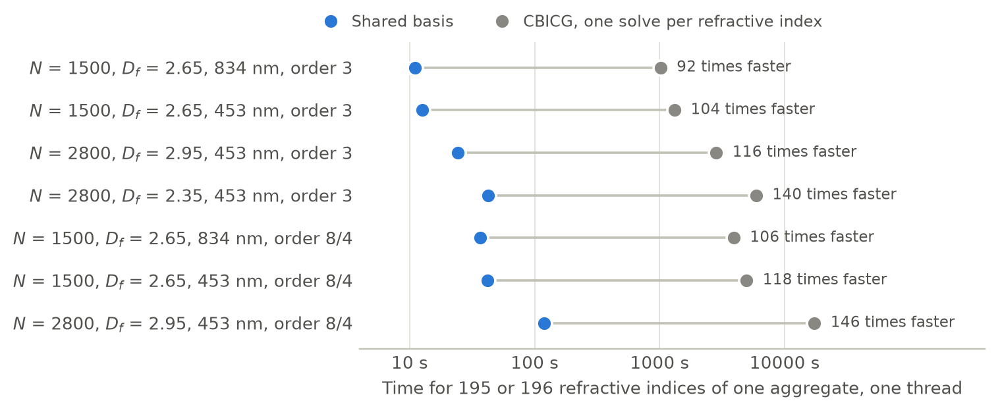
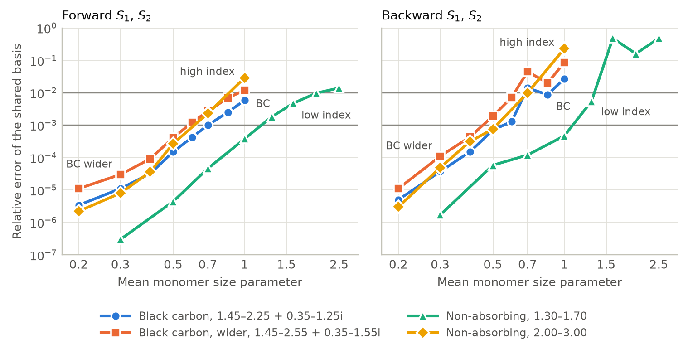

# MSTMforCAS.jl

[](Project.toml)

Julia implementation of the Multi-Sphere T-Matrix (MSTM) method, specialized for Complex Amplitude Sensing (CAS) applications.

## Purpose

Compute numerically exact light scattering solutions for particles consisting of multiple homogeneous spheres (possibly of different sizes) at high speed. This package re-implements, from scratch in Julia, the subset of [Mackowski's MSTM v4.0](https://github.com/dmckwski/MSTM) (Fortran/MPI) functionality required for Complex Amplitude Sensing (CAS). In practice, the code is well suited for parameter sweeps over wavelength, medium refractive index, particle refractive index, and particle morphology (e.g., fractal dimension of aggregates).

Reference implementation: [MSTM-v4.0_for_CAS](https://github.com/NobuhiroMoteki/MSTM-v4.0_for_CAS) (Fortran/MPI).

**Changes and corrections:** see [CHANGELOG.md](CHANGELOG.md). Its first section lists the corrections that change numerical results, with the affected versions.

The theory and the numerical methods are described in [docs/theory_note.pdf](docs/theory_note.pdf). Its sections are:

| Section | Content |
|---|---|
| 1 | Problem setup, VSWF expansion, left–right circular basis, table of notation |
| 2 | Lorenz–Mie coefficients and the T-matrix of a sphere |
| 3 | Interaction equation, incident coefficients, truncation order for touching spheres, translation matrix, FFT translation |
| 4 | Solvers: CBICG, GMRES, continuation in the refractive index, GPU batches |
| 5 | Refractive-index sweep with a shared Krylov basis |
| 6 | Scattering amplitudes and efficiencies |
| 7 | Cluster T-matrix and particle orientation |
| 8 | Validation against the Fortran code |
| 9 | Computational flow and mapping of the equations to the functions |

## Physical Scope

- Infinite homogeneous medium, plane wave incidence along z-axis (fixed orientation)
- Aggregates of homogeneous spheres (each monomer with its own radius, common complex refractive index)
- Output per (aggregate, medium condition, refractive index) combination:
  - Forward/backward scattering amplitude matrix S₁–S₄ (BH83 convention, dimensionless) and S₁₁, S₂₂, S₁₂, S₂₁ (MI02 convention, dimension of length)
  - Polarization-averaged efficiency factors $Q_\mathrm{ext}$, $Q_\mathrm{abs}$, $Q_\mathrm{sca}$ (unpolarized incidence)

**Note on particle orientation:** `compute_scattering` and `run_parameter_sweep` solve for one fixed orientation, with the incident wave along +z. For another orientation, rotate the aggregate geometry (.ptsa/.pos) before the call. For many orientations of one aggregate, `build_cluster_tmatrix` builds the cluster T-matrix once, and `cluster_forward_amplitudes` returns the forward amplitudes S₁–S₄ at any orientation (ZYZ Euler angles) by a Wigner-D rotation. This path uses direct translation only (no FFT) and gives the forward amplitudes only. The design is described in [docs/design_wigner_d_multiorientation.md](docs/design_wigner_d_multiorientation.md).

### Convention definitions

**BH83** = Bohren & Huffman (1983), Eq. 3.12. The amplitude matrix relates scattered to incident field:

```math
\begin{pmatrix} E_{\parallel}^{\mathrm{sca}} \\ E_{\perp}^{\mathrm{sca}} \end{pmatrix} = \frac{e^{ikr}}{-ikr} \begin{pmatrix} S_2 & S_3 \\ S_4 & S_1 \end{pmatrix} \begin{pmatrix} E_{\parallel}^{\mathrm{inc}} \\ E_{\perp}^{\mathrm{inc}} \end{pmatrix}
```

where $S_1, S_2, S_3, S_4$ are dimensionless complex scattering amplitudes.

**MI02** = Mishchenko, Travis & Lacis (2002). Conversion from BH83:

```math
S_{11}^{\mathrm{MI02}} = \frac{S_2^{\mathrm{BH83}}}{-ik}, \quad S_{12}^{\mathrm{MI02}} = \frac{S_3^{\mathrm{BH83}}}{ik}, \quad S_{21}^{\mathrm{MI02}} = \frac{S_4^{\mathrm{BH83}}}{ik}, \quad S_{22}^{\mathrm{MI02}} = \frac{S_1^{\mathrm{BH83}}}{-ik}
```

where $k = k_{\mathrm{medium}} = 2\pi n_{\mathrm{medium}} / \lambda_0$ is the wavenumber in the medium. The MI02 amplitudes have dimension of length.

**Efficiency factors**:

```math
Q = \frac{C}{\pi R_{\mathrm{ve}}^2}, \qquad R_{\mathrm{ve}} = \left(\sum_i r_i^3\right)^{1/3}
```

where $C$ is the cross section and $R_{\rm ve}$ is the volume-equivalent sphere radius.

**Phase reference of the amplitudes** (keyword `phase_reference`, version 1.3.0):

- `:particle` (default): the incident and the scattered wave both refer to the unweighted mean of the sphere centres, $\boldsymbol{r}_0$. Translating the input changes none of the outputs. The forward amplitude is the translation-invariant amplitude that a measurement of $S(0^\circ)$ gives, and $Q_\mathrm{ext} = (4/x_\mathrm{ve}^2)\,\mathrm{Re}\,[S_1(0^\circ) + S_2(0^\circ)]/2$ holds. The backward amplitude refers to $\boldsymbol{r}_0$.
- `:lab`: the incident wave is phased at the plane $z = 0$ of the input coordinates and the scattered wave at $\boldsymbol{r}_0$. This is the convention of the amplitudes printed by the Fortran code MSTM-v4.0_for_CAS and of all versions before 1.3.0. Both amplitudes then carry the factor $e^{ikz_0}$, where $z_0$ is the $z$ coordinate of $\boldsymbol{r}_0$.

The two differ only when $\boldsymbol{r}_0$ is not at the origin of the input. Aggregates centred on their mass centroid with monomers of unequal radii are such a case: in black-carbon tables of PTSA aggregates the factor was 2.2° rms at 637 nm in water and up to 29° for single orientations. Convert stored `:lab` amplitudes with the factor $e^{-ikz_0}$, computed in the frame of the calculation (after any rotation). No new solution is needed. Sweep files record the convention in the attribute `phase_reference`. Files without it come from versions before 1.3.0 and use `:lab`. See the theory note, Sec. 6.3.

## Installation

For full from-scratch setup instructions on **Windows (WSL2 + Ubuntu)** and **native Linux (Ubuntu)**, see [docs/installation_guide.md](docs/installation_guide.md). The summary below assumes Julia ≥ 1.10 and a working build toolchain are already in place.

### From GitHub (new machine)

```bash
git clone https://github.com/NobuhiroMoteki/MSTMforCAS.jl.git
cd MSTMforCAS.jl
julia --project=. -e 'using Pkg; Pkg.instantiate()'
```

This installs all CPU dependencies from the lock file (`Manifest.toml`). To verify:

```bash
julia --project=. -e 'using Pkg; Pkg.test()'
```

### GPU support (optional)

The package works without a GPU and without CUDA.jl. CUDA.jl is a weak dependency: `Pkg.instantiate()` does not install it, and the GPU code is a package extension that loads only when CUDA.jl is loaded.

To use the GPU solver you need an NVIDIA GPU with its driver, and CUDA.jl in an environment that Julia can see. Install it in the default environment, not in the project:

```bash
julia -e 'using Pkg; Pkg.add("CUDA")'
```

The GPU code is tested with CUDA.jl 5 (5.11.0) and 6 (6.5.1). For another major version the package issues a warning when CUDA.jl is loaded, and sweeps run on the CPU.

Julia does not check that the CUDA.jl of the default environment fits the packages of the project. A mismatch shows up as an error from the CUDA extension of another package when CUDA.jl is loaded (for example `LinearOperatorsCUDAExt` with a recent LinearOperators.jl and CUDA.jl 5). Bring both environments up to date in that case:

```bash
julia -e 'using Pkg; Pkg.update()'
julia --project=. -e 'using Pkg; Pkg.update()'
```

Do not run this command with `--project=.`. That would move CUDA.jl into the dependencies of `Project.toml`, and every CPU-only installation would then download it.

Verify GPU detection and that the extension loads:

```bash
julia --project=. -e 'using MSTMforCAS, CUDA; println(CUDA.functional()); println(CUDA.name(CUDA.device()))'
```

CUDA.jl downloads the CUDA toolkit itself, so no manual CUDA installation is needed. The scripts load CUDA.jl when `--gpu` or `--float32` is given. If `use_gpu = true` is set and CUDA.jl is not loaded, the sweep issues a warning and runs on the CPU.

### Dependencies

| Package | Purpose |
|---------|---------|
| SpecialFunctions.jl | Spherical Bessel functions |
| FFTW.jl | FFT-accelerated translation |
| Krylov.jl + LinearOperators.jl | GMRES iterative solver (optional, via `solver=:gmres`) |
| CUDA.jl | GPU-accelerated batched solver (optional, via `use_gpu=true`) |
| HDF5.jl | Incremental output storage for large parameter sweeps |
| CSV.jl + DataFrames.jl | Reading aggregate catalog (input side) |
| LinearAlgebra (stdlib) | Matrix operations |
| Printf (stdlib) | Formatted output |

## Usage

### Input parameters and units

All length inputs (positions, radii, wavelength) must be given in **the same physical unit** (e.g., all in μm). The package does NOT assume a particular unit; consistency is all that matters.

| Parameter | Type | Description | Example |
|-----------|------|-------------|---------|
| `medium_conditions` | `Vector{Tuple{Float64,Float64}}` | List of (wavelength, medium_refindex) pairs. Wavelength in the same unit as coordinates. | `[(0.6328, 1.0), (0.6328, 1.33)]` |
| `m_real_range` | `Tuple{Float64,Float64,Int}` | (min, max, n_grid) for real part of **absolute** complex RI (BH83 sign convention). Single value: `(1.6, 1.6, 1)`. | `(1.5, 1.7, 3)` |
| `m_imag_range` | `Tuple{Float64,Float64,Int}` | (min, max, n_grid) for imaginary part (positive κ = absorption). | `(0.0, 0.1, 2)` |
| `use_fft` | `Bool` | FFT-accelerated translation (default `false`; auto-enabled when any aggregate has Np > 20) | `true` |
| `truncation_order` | `Union{Int,Nothing}` | Override VSWF truncation order (default `nothing` = auto) | `8` |
| `truncation_eps` | `Union{Float64,Nothing}` | Target relative accuracy of the forward amplitudes with respect to the truncation order. The order is then chosen for every refractive index by a preliminary two-sphere calculation (default `nothing` = single-sphere Mie criterion only). Suggested: `1e-2` routine, `1e-3` precise. | `1e-2` |
| `fft_far_order` | `Union{Int,Nothing}` | With FFT translation, the multipole order that the grid carries. Higher orders couple near pairs only, by direct translation (default `nothing` = the grid carries all orders). `0` selects the single-sphere Mie order. | `4` |
| `fft_near_factor` | `Float64` | Near-pair criterion for `fft_far_order`: center distance at most this factor times the sum of the radii (default `1.5`) | `1.5` |
| `solver` | `Symbol` | Iterative solver: `:cbicg` (default) or `:gmres` | `:gmres` |
| `phase_reference` | `Symbol` | Point to which the phase of the amplitudes refers: `:particle` (default, the unweighted mean of the sphere centres) or `:lab` (incident wave at z = 0, the convention before 1.3.0). See [Convention definitions](#convention-definitions). Recorded in the file attribute `phase_reference` | `:lab` |
| `use_gpu` | `Bool` | GPU-accelerated batched solver (default `false`; implies `use_fft=true`) | `true` |
| `gpu_float32` | `Bool` | Use Float32 for GPU BiCG iterations (default `false`). It has an effect only together with `use_gpu=true`. The script option `--float32` sets both. | `true` |
| `gpu_np_threshold` | `Int` | Hybrid mode threshold: groups with Np ≤ this value are processed by CPU threads concurrently with the GPU task (default `500`; set to `0` to disable hybrid and send all groups to GPU) | `500` |

The sweep covers the full Cartesian product: **aggregates × medium_conditions × m_real × m_imag**.

**VSWF truncation order**: By default, the truncation order N for each sphere is determined automatically from the size parameter x using the Wiscombe criterion: $N = \mathrm{round}(x + 4x^{1/3}) + 5$, refined by a convergence check on the Mie efficiencies. Typical values: N=4 for x=1.0, N=5 for x=1.5. To override, pass `truncation_order=N` (applied uniformly to all spheres; if smaller than the auto-determined value, the auto value is used as a floor). The actual truncation order used is reported in the output as `truncation_order`.

**Truncation order for touching monomers**: The single-sphere criterion does not resolve the near field between monomers that touch. For small, strongly absorbing monomers the forward amplitudes can then be off by several percent. With `truncation_eps` set, the order is chosen from a two-sphere calculation (`contact_truncation_order`) so that the forward amplitudes of a touching pair are converged to the given relative accuracy.

**FFT translation at high truncation order**: Memory and time of the FFT grid grow steeply with the order that the grid nodes carry. Only pairs of spheres that are close to each other need the high orders. With `fft_far_order = F` the grid carries the orders up to `max(F, Mie order)`. The orders above it are coupled directly for near pairs only. The result then has the accuracy of the FFT translation at order `F`. For a 350-monomer aggregate at sphere order 8, `F = 4` reduced the memory of the translation data from 2.7 GB to 0.6 GB. The forward amplitudes differed from the direct solution by 0.16% with `F = 4` and by 0.09% with the grid carrying all orders.

### Aggregate geometry input

Two input formats are supported:

**1. HDF5 + CSV catalog** (recommended, from [aggregate_generator_PTSA](https://github.com/NobuhiroMoteki/aggregate_generator_PTSA)):

```julia
aggregates = read_aggregate_catalog("aggregates.h5", "catalog.csv")
# Optional filters:
aggregates = read_aggregate_catalog("aggregates.h5", "catalog.csv";
    Df_range=(1.5, 2.5), Np_range=(100, 500), agg_num_range=(0, 2))
```

The CSV catalog columns: `mean_rp, rel_std_rp, k, Df, Np, agg_num, Rve, Rg, eps_agg, h5_file, h5_key`. The HDF5 file stores monomer coordinates (`xp`, 3×Np) and radii (`rp`, Np) at each `h5_key` path. All metadata is automatically populated into `AggregateGeometry` and propagated to the output DataFrame.

**2. Text files** (.ptsa, .pos): plain ASCII, one sphere per line, 4 whitespace-separated columns:

```
x   y   z   r
```

No header. Coordinates and radii in physical units (μm).

```julia
agg = read_aggregate_file("aggregate.ptsa")
```

### Single aggregate computation

```bash
# Direct translation (default)
julia --project=. scripts/run_single.jl

# FFT-accelerated translation (faster for N > ~100 spheres)
julia --project=. scripts/run_single.jl --fft

# Override automatic VSWF truncation order (use N=8 for all spheres)
julia --project=. scripts/run_single.jl --truncation-order 8
```

Or in Julia:

```julia
using MSTMforCAS

# Read aggregate geometry (coordinates in μm)
agg = read_aggregate_file("aggregate.ptsa")

# Physical parameters
wavelength = 0.6328   # [μm]
n_medium   = 1.0
m_sphere   = 1.6 + 0.0123im   # absolute complex RI

# Derived
k_medium = 2π * n_medium / wavelength   # [μm⁻¹]
m_rel    = m_sphere / n_medium           # relative RI

# Compute (direct translation) — returns (ScatteringResult, amn)
result, _ = compute_scattering(agg, m_rel, k_medium)

# Compute (FFT-accelerated translation — faster for N > ~100 spheres)
result, _ = compute_scattering(agg, m_rel, k_medium; use_fft=true)

# Compute with user-specified truncation order
result, _ = compute_scattering(agg, m_rel, k_medium; truncation_order=8)

# Compute with GMRES solver instead of default CBICG
result, _ = compute_scattering(agg, m_rel, k_medium; use_fft=true, solver=:gmres)

# Continuation method: pass previous solution as initial guess for RI sweep
result1, amn1 = compute_scattering(agg, m_rel_1, k_medium; use_fft=true)
result2, amn2 = compute_scattering(agg, m_rel_2, k_medium; use_fft=true, initial_amn=amn1)

# Access results
result.S_forward        # (S₁, S₂, S₃, S₄) BH83, dimensionless, θ=0°
result.S_backward       # (S₁, S₂, S₃, S₄) BH83, dimensionless, θ=180°
result.Q_ext            # extinction efficiency (dimensionless)
result.Q_abs            # absorption efficiency (dimensionless)
result.Q_sca            # scattering efficiency (dimensionless)
result.converged        # solver convergence flag
result.n_iterations     # number of CBICG iterations
result.truncation_order # maximum VSWF truncation order used
```

### Many refractive indices of one aggregate (shared Krylov basis)

Since v1.2.0, `sweep_refractive_index` computes one aggregate at one wavelength for many
refractive indices with one Krylov basis that all refractive indices share. The translation
operator is applied a fixed number of times per aggregate, not once per iteration and
refractive index. For about 200 refractive indices of aggregates with 1500 to 2800 monomers
this was 92 to 146 times faster than one CBICG solve per refractive index on one thread
(see [Performance](#performance)).

```julia
positions_x = agg.positions .* k_medium          # dimensionless, shape (3, N)
radii_x     = agg.radii     .* k_medium          # size parameters, shape (N,)
m_rels = vec([complex(mr, mi) for mr in 1.5:0.1:2.2, mi in 0.4:0.1:1.2])

results, info = sweep_refractive_index(positions_x, radii_x, m_rels; use_fft=true)

results[j]              # ScatteringResult of m_rels[j]
info.basis_size         # basis vectors per incident polarization
info.relres             # true relative residual of every refractive index in the basis
info.n_fallback         # refractive indices that were solved by CBICG instead
```

- All spheres and all refractive indices use one truncation order: the largest single-sphere
  Mie order over the spheres and `m_rels`, or `truncation_order` if that is larger.
- Every result meets `tol` (default `1e-6`, the criterion of the CBICG solver). The true
  residual is checked for every refractive index. A refractive index that the basis does not
  resolve is solved by CBICG, started from the basis solution.
- The method was validated for 1.30 ≤ Re m ≤ 3.00, 0 ≤ Im m ≤ 1.65 and
  max|m| × (largest monomer size parameter) ≤ 1.6. A warning is issued outside this range
  (`shared_basis_range_issues`). Results there still meet `tol`, but the gain in time can be
  lost. Metallic refractive indices are outside the scope of the method.
- The one-solve-per-refractive-index method (`compute_scattering`) is unchanged and remains
  the default of the parameter sweep.

### Parameter sweep

**From HDF5 + CSV catalog** (recommended):

```bash
# Single thread
julia --project=. scripts/run_sweep_h5.jl

# Multi-threaded (4 threads) with FFT
julia -t 4 --project=. scripts/run_sweep_h5.jl --fft
```

Or in Julia:

```julia
using MSTMforCAS

# Load aggregates from HDF5 + CSV catalog
aggregates = read_aggregate_catalog("data/aggregates/aggregates.h5",
                                     "data/aggregates/catalog.csv")

config = SweepConfig(
    medium_conditions = [(0.6328, 1.0), (0.6328, 1.33)],  # (wavelength [μm], n_medium)
    m_real_range = (1.5, 1.7, 3),    # (min, max, n_grid) for Re(m)
    m_imag_range = (0.0, 0.1, 2),    # (min, max, n_grid) for Im(m)
    use_fft          = true,          # FFT-accelerated translation
    truncation_order = nothing,       # nothing = automatic, or Int to override
)

# Run sweep — results written incrementally to HDF5 (safe to interrupt and resume)
run_parameter_sweep(aggregates, config; output_h5="results.h5")
```

`run_parameter_sweep` returns `nothing`; all results are written directly to the HDF5 file. If the file already exists, completed jobs are detected automatically and skipped (resume support).

**Shared Krylov basis in the sweep** (v1.2.0, optional): `SweepConfig(...; shared_basis = true)` or `scripts/run_sweep_h5.jl --shared-basis` solves all refractive indices of each (aggregate, medium condition) group with `sweep_refractive_index`. The default (`shared_basis = false`) is one CBICG solve per refractive index, as in earlier versions, and its results do not change. With the shared basis one truncation order is used for the whole group, so the rows differ from those of the default at the level of the truncation error. The two kinds of rows cannot share an output file. The option is for CPU sweeps and is not available together with `use_gpu`.

**From .ptsa text files** (alternative):

```bash
julia -t 4 --project=. scripts/run_sweep_small.jl [--fft] [--truncation-order N]
```

```julia
aggregates = [read_aggregate_file(f) for f in readdir("aggregates/", join=true)]
run_parameter_sweep(aggregates, config; output_h5="results.h5")
```

### Output data format

Results are stored in HDF5 format. Each column is a 1-D dataset of length equal to the number of completed jobs. There are 51 columns per row (one row = one aggregate × medium_condition × refractive_index combination):

#### Aggregate metadata and material

| Column | Type | Unit | Description | Category |
|--------|------|------|-------------|----------|
| `source` | String | — | Source identifier (h5_key or file path) | — |
| `mean_rp` | Float64 | [μm] | Mean monomer radius | constant |
| `rel_std_rp` | Float64 | — | Relative std dev of monomer radius | constant |
| `k_f` | Float64 | — | Fractal prefactor | constant |
| `Df` | Float64 | — | Fractal dimension | sweep |
| `n_monomers` | Int | — | Number of monomers | sweep |
| `agg_num` | Int | — | Aggregate index | sweep |
| `R_ve` | Float64 | [μm] | Volume-equivalent sphere radius | derived |
| `R_g` | Float64 | [μm] | Radius of gyration | derived |
| `eps_agg` | Float64 | — | Aggregate porosity | derived |
| `wavelength` | Float64 | [μm] | Vacuum wavelength | sweep |
| `medium_refindex` | Float64 | — | Medium refractive index | sweep |
| `m_real` | Float64 | — | Real part of **absolute** refractive index | sweep |
| `m_imag` | Float64 | — | Imaginary part of **absolute** refractive index | sweep |

Note: When reading from .ptsa text files, metadata fields (`mean_rp`, `rel_std_rp`, `k_f`, `Df`, `agg_num`) are automatically parsed from the filename if it follows the naming convention `meanRp={val}um_rstdRp={val}_k={val}_Df={val}_Np={val}_agg_num={val}.ptsa`. Fields `R_g` and `eps_agg` are only available via the HDF5+CSV catalog and will be `NaN` when reading text files.

#### Forward scattering amplitudes (θ = 0°)

| Columns | Convention | Unit | Description |
|---------|------------|------|-------------|
| `S1_fwd_re`, `S1_fwd_im` | BH83 | dimensionless | S₁(0°) = perpendicular amplitude |
| `S2_fwd_re`, `S2_fwd_im` | BH83 | dimensionless | S₂(0°) = parallel amplitude |
| `S3_fwd_re`, `S3_fwd_im` | BH83 | dimensionless | S₃(0°) = cross-pol amplitude |
| `S4_fwd_re`, `S4_fwd_im` | BH83 | dimensionless | S₄(0°) = cross-pol amplitude |
| `S11_fwd_re`, `S11_fwd_im` | MI02 | [length] | S₁₁(0°) = S₂/(−ik) |
| `S22_fwd_re`, `S22_fwd_im` | MI02 | [length] | S₂₂(0°) = S₁/(−ik) |
| `S12_fwd_re`, `S12_fwd_im` | MI02 | [length] | S₁₂(0°) = S₃/(ik) |
| `S21_fwd_re`, `S21_fwd_im` | MI02 | [length] | S₂₁(0°) = S₄/(ik) |

#### Backward scattering amplitudes (θ = 180°)

Same structure as forward with `_bwd` suffix (16 columns total).

#### Efficiency factors and diagnostics

| Column | Type | Unit | Description |
|--------|------|------|-------------|
| `Q_ext` | Float64 | dimensionless | Extinction efficiency (unpolarized incidence) |
| `Q_abs` | Float64 | dimensionless | Absorption efficiency (= Q_ext − Q_sca, see the note on accuracy under [Validation](#validation)) |
| `Q_sca` | Float64 | dimensionless | Scattering efficiency (from the expansion about the common origin) |
| `converged` | Int8 | — | Whether CBICG solver converged (1 = yes, 0 = no) |
| `n_iterations` | Int | — | Number of CBICG iterations used |
| `truncation_order` | Int | — | Maximum VSWF truncation order used |

**Unit note for MI02 amplitudes**: The MI02 amplitude unit [length] is the same as the wavelength and coordinate unit. For example, if `wavelength` is in μm, then S₁₁ etc. are in μm.

**Physical cross sections** are not stored in the output, but can be computed as: $C = Q \times \pi \times R_\mathrm{ve}^2$ (same length unit squared).

### Reading output files

**HDF5:**

```julia
using HDF5

h5open("data/results/results_fullsweep_agg20260316_00.h5", "r") do fid
    # Each column is a 1-D array (length = number of jobs)
    wavelength     = read(fid["wavelength"])
    medium_refindex = read(fid["medium_refindex"])
    agg_num    = read(fid["agg_num"])
    n_monomers = read(fid["n_monomers"])
    Df         = read(fid["Df"])
    m_real     = read(fid["m_real"])
    m_imag     = read(fid["m_imag"])
    R_ve       = read(fid["R_ve"])
    Q_ext      = read(fid["Q_ext"])
    Q_abs      = read(fid["Q_abs"])
    Q_sca      = read(fid["Q_sca"])

    # MI02 forward scattering amplitudes (complex, dimension of length [μm])
    S11_fwd = read(fid["S11_fwd_re"]) .+ im .* read(fid["S11_fwd_im"])
    S22_fwd = read(fid["S22_fwd_re"]) .+ im .* read(fid["S22_fwd_im"])
    S12_fwd = read(fid["S12_fwd_re"]) .+ im .* read(fid["S12_fwd_im"])
    S21_fwd = read(fid["S21_fwd_re"]) .+ im .* read(fid["S21_fwd_im"])

    # MI02 backward scattering amplitudes
    S11_bwd = read(fid["S11_bwd_re"]) .+ im .* read(fid["S11_bwd_im"])
    S22_bwd = read(fid["S22_bwd_re"]) .+ im .* read(fid["S22_bwd_im"])
    S12_bwd = read(fid["S12_bwd_re"]) .+ im .* read(fid["S12_bwd_im"])
    S21_bwd = read(fid["S21_bwd_re"]) .+ im .* read(fid["S21_bwd_im"])

    # Filter by condition: wavelength=0.6328, n_medium=1.0, agg_num=0, Np=100, Df=2.35, m=1.6+0.0123i
    idx = findall(i -> wavelength[i] == 0.6328 && medium_refindex[i] == 1.0 &&
                       agg_num[i] == 0 && n_monomers[i] == 100 &&
                       Df[i] == 2.35 && m_real[i] == 1.6 && m_imag[i] == 0.0123,
                  eachindex(agg_num))

    for i in idx
        println("R_ve=$(R_ve[i]), Q_ext=$(Q_ext[i]), Q_abs=$(Q_abs[i]), Q_sca=$(Q_sca[i])")
        println("  MI02 fwd: S11=$(S11_fwd[i]), S22=$(S22_fwd[i]), S12=$(S12_fwd[i]), S21=$(S21_fwd[i])")
        println("  MI02 bwd: S11=$(S11_bwd[i]), S22=$(S22_bwd[i]), S12=$(S12_bwd[i]), S21=$(S21_bwd[i])")
    end
end
```

or with the provided script:

```bash
julia --project=. scripts/read_results_h5.jl data/results/results_fullsweep_agg20260316_00.h5
```

HDF5 files also store sweep config as root-level attributes: `medium_conditions_wavelength`, `medium_conditions_refindex`, `m_real_range`, `m_imag_range`, `n_jobs`.

**CAS-specific parameter lookup** (interactive use):

```bash
julia --project=. scripts/read_results_h5_for_cas.jl <results.h5> [i_medium] [i_agg] [i_Np] [i_Df] [i_m_real] [i_m_imag]
```

This script reads an HDF5 results file and outputs CAS-v2 observable quantities for a specific parameter combination specified by 1-based array indices:

- `Ss_fwd = S11_fwd + S12_fwd * i` — s-polarization forward complex scattering amplitude [μm]
- `Sp_fwd = S22_fwd - S21_fwd * i` — p-polarization forward complex scattering amplitude [μm]
- `S_bak = (-S11_bwd + S22_bwd) / 2` — backward scattering amplitude of the OCBS signal [μm]
- `R_ve`, `Q_ext`, `Q_abs`, `Q_sca`

where S11, S12, S21, S22 are the MI02-convention amplitude matrix elements.

`S_bak` follows the corrected Eq. (28) of Moteki and Adachi (2024), given in the erratum to that paper. The printed equation has `1/√2` in place of `1/2`. All versions before 1.1.0 (the release v1.0.1 and versions up to 0.4.5) followed the printed equation, so their `S_bak` is `√2` times the present value, with the same phase. The HDF5 result files store `S11_bwd` and `S22_bwd` and are not affected. The forward amplitudes and the efficiencies are not affected either. block-DDA_Py (from v0.8.2) and block-VIEM.jl (from v0.8.0) use the same corrected definition.

When run without index arguments (or with all indices set to 1), it first lists the available parameter values and their counts:

```text
Available parameter values:
  medium   (2): [(0.6328, 1.0), (0.6328, 1.33)]  # (wavelength, n_medium)
  agg_num  (3): [0, 1, 2]
  Np       (4): [100, 200, 300, 400]
  Df       (2): [2.35, 2.95]
  m_real   (2): [1.5, 1.6]
  m_imag   (2): [0.0, 0.0123]
```

The numbers in parentheses are the upper limits for each index. In this example, valid ranges are `i_medium`=1–2, `i_agg`=1–3, `i_Np`=1–4, `i_Df`=1–2, `i_m_real`=1–2, `i_m_imag`=1–2.

Example:

```bash
# Select medium=(0.6328,1.33) (2nd), agg_num=1 (2nd), Np=200 (2nd), Df=2.35 (1st), m=1.6+0.0123i
julia --project=. scripts/read_results_h5_for_cas.jl data/results/results_fullsweep_agg20260316_00.h5 2 2 2 1 2 2
```

**Using results from Python**: The `.h5` file is self-contained and can be read directly with `h5py` without any Julia dependency. See [docs/technical_note_use_results_from_python.md](docs/technical_note_use_results_from_python.md) for the HDF5 structure reference, CAS-v2 observable formulas, and a ready-to-use `read_cas_results()` Python function.

## Project Structure

```text
MSTMforCAS.jl/
├── Project.toml
├── CHANGELOG.md               # Changes by version, corrections that change results
├── src/
│   ├── MSTMforCAS.jl          # Top-level module
│   ├── MieCoefficients.jl     # Lorenz-Mie coefficients aₙ, bₙ
│   ├── TranslationCoefs.jl    # VSWF translation addition theorem
│   ├── FFTTranslation.jl      # FFT-accelerated translation (O(N + M log M))
│   ├── TMatrixSolver.jl       # CBICG and GMRES iterative solvers
│   ├── ScatteringAmplitude.jl  # Amplitudes + cross sections
│   ├── SharedBasisSweep.jl    # Refractive-index sweep of one aggregate with a shared Krylov basis
│   ├── TruncationOrder.jl     # Truncation order from a two-sphere preliminary calculation
│   ├── WignerRotation.jl      # Wigner d and D matrices
│   ├── ClusterTMatrix.jl      # Cluster T-matrix and forward amplitudes at any orientation
│   ├── AggregateIO.jl         # Read .ptsa/.pos and HDF5+CSV catalog
│   └── ParameterSweep.jl      # Parallel parameter sweeps
├── ext/
│   └── MSTMforCASCUDAExt/     # CUDA.jl extension for GPU batched solver
│       ├── gpu_types.jl       # GPU data structures and memory management
│       ├── gpu_kernels.jl     # CUDA kernels (T-matrix, S-parity, BiCG ops)
│       ├── gpu_fft_translation.jl  # Batched FFT translation operator
│       └── gpu_batch_solver.jl     # Batched BiCG solver + pipeline
├── data/
│   ├── aggregates/            # HDF5 + CSV from aggregate_generator_PTSA
│   └── results/               # MSTM computation results (CSV/HDF5)
├── scripts/
│   ├── run_single.jl          # Single aggregate computation
│   ├── run_single_1sphere.jl  # Single sphere, for comparison with Mie theory
│   ├── run_sweep_h5.jl        # Parameter sweep from HDF5 catalog
│   ├── run_sweep_h5_extension.jl   # Sweep of an extended refractive index range
│   ├── run_sweep_h5_regen.jl  # Regeneration of the black-carbon LUT sweep (core, ext, ext2 grids)
│   ├── run_sweep_small.jl     # Parameter sweep from .ptsa files
│   ├── run_doublet_sweep.jl   # Two-sphere sweep over orientation
│   ├── run_sampled_lut.jl     # Sampled table over geometry and orientation
│   ├── merge_sweep_h5.jl      # Merge sweep files row by row (optional Df range)
│   ├── merge_extension_h5.jl  # Merge a base sweep file with its extension
│   ├── validate_testcases.jl  # Validation against Fortran reference
│   ├── read_results_csv.jl    # Read and summarize CSV output
│   ├── read_results_h5.jl     # Read and summarize HDF5 output
│   └── read_results_h5_for_cas.jl  # CAS-specific parameter lookup from HDF5
├── docs/
│   ├── theory_note.pdf             # Mathematical formulation of MSTM theory (source: theory_note.tex)
│   ├── figs/                       # Figures of the theory note and the README, with data and script
│   ├── installation_guide.md       # Setup on WSL2 and native Linux
│   ├── design_wigner_d_multiorientation.md  # Design of the cluster T-matrix and orientation path
│   └── technical_note_use_results_from_python.md  # Python reader guide + code
└── test/                      # Unit tests, with Fortran reference values for aggregates of unequal spheres
                               #   and the translation invariance of the amplitudes (test_phase_reference.jl)
    └── fixtures/              # Sphere positions of the test aggregates
```

## Validation

The package was compared with the Fortran code MSTM-v4.0_for_CAS. The Fortran code phases the incident wave at z = 0, so these comparisons use `phase_reference = :lab`. The Fortran output has four significant digits for the amplitudes and five for the efficiencies, so differences of about 2e-4 are at its printed precision. The numbers below are relative differences. Section 8 of the theory note has the details.

**Test cases of the Fortran distribution** (equal spheres, default tolerance 1e-6):

| Quantity | testcase1 (2 spheres, direct) | testcase2 (1000 spheres, direct) | testcase3 (1000 spheres, FFT) |
|---|---|---|---|
| Forward S₁, S₂ | 1.9e-4 | 2.1e-4 | 2.4e-4 |
| Backward S₁, S₂ | 5.7e-5 | 2.3e-4 | 1.5e-2 |
| $Q_\mathrm{ext}$ | 8.1e-6 | 2.5e-5 | 1.3e-5 |
| $Q_\mathrm{sca}$ | 1.5e-4 | 1.3e-5 | 5.6e-4 |
| $Q_\mathrm{abs}$ | 5.0e-4 | 1.4e-4 | 1.6e-2 |
| Iterations (package / Fortran) | 3 / 3 | 18 / 18 | 18 / 18 |

**Aggregates with unequal monomer radii** (relative standard deviation of the radii 0.08 to 0.10, size parameters 0.21 to 0.32, direct translation in both codes):

| Comparison | Forward S₁, S₂ | Backward S₁, S₂ | $Q_\mathrm{ext}$ |
|---|---|---|---|
| 10 new Fortran runs, 20 to 504 monomers, m = 1.95+0.79i and 1.60+0.0123i (largest difference) | 2.5e-4 | 2.9e-4 | 3.6e-5 |
| 346 Fortran outputs, 20 monomers, grid of refractive indices (median / largest) | 1.7e-4 / 4.4e-4 | 6.7e-5 / 3.1e-4 | 9.2e-6 / 4.7e-5 |

The truncation orders and the numbers of iterations are the same in the two codes. With the tolerance 1e-12 in both codes, $Q_\mathrm{abs}$ and $Q_\mathrm{sca}$ also agree to the printed precision.

**Notes on accuracy.**

- **Direct translation**: the amplitudes S₁, S₂ and $Q_\mathrm{ext}$ agree with the Fortran output to its printed precision in all cases.
- **$Q_\mathrm{abs}$ of weakly absorbing aggregates**: the package computes $Q_\mathrm{abs} = Q_\mathrm{ext} - Q_\mathrm{sca}$, so $Q_\mathrm{abs}$ carries the absolute error of $Q_\mathrm{ext}$. With the default tolerance its relative error reached 3e-3 for an aggregate of 504 monomers with m = 1.60+0.0123i. With FFT translation it reached 1.6e-2 in testcase3. Use a smaller `tol` and direct translation when $Q_\mathrm{abs}$ of such aggregates is needed to better than a percent. For strongly absorbing aggregates such as black carbon the effect is small.
- **FFT translation**: it is an approximation. In testcase3 it changes the forward S₁, S₂ by 8e-4 and the backward S₁ by 2.7e-2 against direct translation, and the Fortran code shows changes of the same size. For an aggregate of 20 monomers the FFT translation of the package differs from direct translation by up to 1.7e-3 in the forward and 6.7e-3 in the backward amplitudes.
- **Backward amplitudes of large aggregates**: the default tolerance leaves errors of up to 2 % for 1500 to 2800 monomers (theory note, Sec. 4.2).

Run the three test cases:

```bash
julia --project=. scripts/validate_testcases.jl
```

The comparison for unequal radii is part of the test suite (`test/test_fortran_unequal_radii.jl`).

## Performance

### Direct vs FFT translation

The FFT-accelerated translation replaces O(N²) pairwise sphere-to-sphere translation with O(N + M log M) grid-based convolution (M = number of grid cells). This provides a large speedup for aggregates with many monomers.

| Mode | Algorithm | Complexity | Best for |
|------|-----------|------------|----------|
| `use_fft=false` (default) | Direct pairwise | O(N² × n_order²) per iteration | N < ~100 |
| `use_fft=true` | FFT convolution + near-field correction | O(N + M log M) per iteration | N > ~100 |

### Benchmark: testcase2/3 (1000 spheres, x=1.0, m=1.6+0.0123i)

All timings on a single core (no MPI, no multi-threading). Julia version: 1.11, Fortran: MSTM-v4.0_for_CAS with `mpiexec -n 1`.

| | Julia direct | Julia FFT | Fortran direct (1 proc) | Fortran FFT (1 proc) |
|---|---|---|---|---|
| Solver time | 301 s | 7.2 s | 96.4 s | 3.3 s |
| Speedup vs Julia direct | 1× | **42×** | — | — |
| Iterations | 18 | 18 | 18 | 18 |
| Peak memory | ~2 GB | ~0.5 GB | ~0.5 GB | ~0.1 GB |

**Julia vs Fortran speed**: The Julia direct solver is ~3× slower than single-process Fortran for this test case. The Julia FFT solver is ~2× slower than the Fortran FFT solver. Key optimizations applied: stride-1 translation coefficient layout, batched FFTW plans (6× on FFT convolution), precomputed near-field translation matrices, and precomputed T-matrix lookup tables.

**Memory**: Julia FFT mode uses ~0.5 GB (including ~190 MB for cached near-field translation matrices). For practical CAS parameter sweeps (N ≤ 1000), memory is not a bottleneck.

**Multi-threading**: In CPU-only mode, parallelisation is at the **parameter sweep level**: jobs are grouped by (aggregate, medium_condition), and `Threads.@threads :dynamic` distributes groups across threads with work-stealing load balancing. Groups are sorted by descending monomer count so large aggregates start first, improving dynamic load balance. Within each group, all refractive index values share the precomputed FFT grid. Start Julia with `julia -t auto` or `julia -t N`.

In **GPU hybrid mode** (`-t auto --float32` or `--gpu`), two levels of parallelism are active simultaneously:
1. **Intra-group (Approach A)**: `Threads.@threads` parallelises CPU batch preparation and post-processing within each GPU group, directly reducing GPU idle time.
2. **Inter-group (Approach B)**: a dedicated GPU task handles large-Np groups sequentially while `Threads.@threads :dynamic` processes small-Np groups (Np ≤ `gpu_np_threshold`) on CPU cores concurrently, so no core sits idle while the GPU is busy.

This task-level parallelism is far more efficient than parallelizing within a single solver call because: (1) each job is fully independent — zero inter-thread communication and synchronization; (2) intra-solver parallelism (e.g., threading the O(N²) translation loop) would require synchronization at every BiCG iteration, and Amdahl's law limits the practical speedup to 2–5×. For typical CAS parameter sweeps (thousands of jobs), task-level parallelism with C cores gives ~C× speedup as long as the number of jobs exceeds C.

**Continuation method for RI sweeps**: When sweeping over refractive indices for the same aggregate geometry, `run_parameter_sweep` automatically uses the previous solution as the initial guess for the iterative solver (continuation method). This reduces the number of CBICG iterations for each subsequent RI grid point. Benchmark results (1000 spheres, FFT mode, $\Delta m \approx 0.05$):

| | Cold start | Warm start (continuation) |
|---|---|---|
| Iterations per point | 15 | 9–11 (after 1st point) |
| Total time (8 RI points) | 46.3 s | 38.4 s |
| Speedup | — | **1.2×** |

The speedup is most significant for large aggregates where the solver requires many iterations. For small aggregates (Np~100, ~4 iterations), the improvement is marginal. The continuation is applied automatically within each (aggregate, medium_condition) group and has zero overhead when not beneficial (dimension mismatch triggers automatic fallback to the default initial guess).

**Snake-path grid traversal** (v0.4.1): The 2-D refractive index grid ($m_\mathrm{real} \times m_\mathrm{imag}$) is traversed in a snake (boustrophedon) pattern — the $m_\mathrm{imag}$ sweep direction alternates on each $m_\mathrm{real}$ row. This keeps consecutive grid points at a uniform step size ($|\Delta m| = 0.1$ for a 14×14 grid with $1.65 \leq m_\mathrm{real} \leq 2.95$ and $0.15 \leq m_\mathrm{imag} \leq 1.45$), eliminating the large jumps ($|\Delta m| \approx 1.3$) at row boundaries that occur with naive raster ordering. This maximizes continuation effectiveness at all grid points.

**Progress and crash recovery**: Results are flushed to HDF5 every ~60 seconds with a result snapshot (CAS amplitudes, Q_ext). Remaining time is estimated from the observed job completion rate, displayed in days. If the process is interrupted, restarting with the same output file automatically resumes from where it left off.

Thread safety: the translation coefficient cache is pre-warmed single-threaded before the parallel section. HDF5 writes are serialized via a lock.

### Refractive-index sweep with a shared Krylov basis (v1.2.0)

One aggregate, 195 or 196 refractive indices (1.35 ≤ Re m ≤ 2.95, 0.15 ≤ Im m ≤ 1.55), FFT translation, MSTMforCAS.jl v1.2.0, one thread of a server with Xeon E5-2620 v4 processors. The times include the setup of the translation. "CBICG" is one solve per refractive index with `tol = 1e-6` and cold start, extrapolated from three refractive indices. The errors are those of the shared basis against CBICG solutions with `tol = 1e-14` at the same truncation order. "8/4" is the truncation order 8 with `fft_far_order = 4`.

| Np | Df | Wavelength | Order | Basis size | CBICG | Shared basis | Speed-up | Error forward S₁,S₂ | Error backward S₁,S₂ |
|---|---|---|---|---|---|---|---|---|---|
| 1500 | 2.65 | 834 nm | 3 | 14 | 1016 s | 11.0 s | 92 | 1.6e-5 | 2.7e-5 |
| 1500 | 2.65 | 453 nm | 3 | 18 | 1316 s | 12.6 s | 104 | 2.3e-5 | 2.1e-4 |
| 2800 | 2.95 | 453 nm | 3 | 27 | 2837 s | 24.4 s | 116 | 8.7e-6 | 1.2e-3 |
| 2800 | 2.35 | 453 nm | 3 | 18 | 5914 s | 42.2 s | 140 | 2.3e-5 | 2.4e-4 |
| 1500 | 2.65 | 834 nm | 8/4 | 16 | 3913 s | 36.8 s | 106 | 1.6e-5 | 3.4e-5 |
| 1500 | 2.65 | 453 nm | 8/4 | 20 | 4953 s | 41.9 s | 118 | 1.8e-5 | 1.1e-4 |
| 2800 | 2.95 | 453 nm | 8/4 | 30 | 17293 s | 118.2 s | 146 | 1.0e-5 | 4.5e-4 |



In the figure N is the number of monomers (Np).

In a parameter sweep (`shared_basis = true`, six threads, six aggregates × 100 refractive indices, uniform order 3) the gain against the default with continuation was a factor of 28 for Np = 1500 at 834 nm (17.6 s against 485 s) and a factor of 20 for Np = 350 at 453 nm (3.4 s against 67 s). All rows converged without the fallback. The factors are smaller than in the table because the sweep has half as many refractive indices and the default starts every solve from the previous solution.

The stage that is repeated for every refractive index takes 5 ms (first row) to 95 ms (last row) per refractive index, so the speed-up grows with the number of refractive indices. In an earlier test with a prototype of the method, twelve processes at once on a 24-thread desktop each ran at about 55 % of the single-process speed. With the default tolerance the CBICG results themselves differ from the tight solutions by 2e-4 to 5e-4 in the forward amplitudes and by up to 2 % in the backward amplitudes of the larger aggregates.

**Range of use.** The gain depends on the monomer size and the refractive index, because the basis resolves the solution less well as |m| × (size parameter) grows. The table gives the mean monomer size parameter x up to which the shared basis alone keeps the relative error of S₁, S₂ below 1e-3 and 1e-2. Above these values more refractive indices go to the CBICG fallback: the results stay within the tolerance, and the gain in time shrinks.

| Material class | Re m | Im m | Truncation order | Forward: 1e-3 | Forward: 1e-2 | Backward: 1e-3 | Backward: 1e-2 |
|---|---|---|---|---|---|---|---|
| Black carbon | 1.45 to 2.25 | 0.35 to 1.25 | 7 to 8 | x ≤ 0.70 | x ≤ 1.1 (extrapolated) | x ≤ 0.55 | x ≤ 0.70 |
| Black carbon, wider range | 1.45 to 2.55 | 0.35 to 1.55 | 9 to 11 | x ≤ 0.58 | x ≤ 0.95 | x ≤ 0.45 | x ≤ 0.60 |
| Non-absorbing, low index | 1.30 to 1.70 | 0 | 3 to 5 | x ≤ 1.2 | x ≤ 2.0 | x ≤ 1.1 | x ≤ 1.3 |
| Non-absorbing, high index | 2.00 to 3.00 | 0 | 7 to 9 | x ≤ 0.60 | x ≤ 0.85 | x ≤ 0.50 | x ≤ 0.70 |
| Metals | below 1 | above 1.5 | — | out of scope | | | |



The figure shows the error of the basis alone (without the fallback) for the four classes. The horizontal lines mark 1e-3 and 1e-2.

- Conditions: the central 60 spheres of an aggregate with Df = 2.65, direct translation, radii with a relative standard deviation of 0.1 (largest sphere 1.22 times the mean). The truncation order is the one that a touching pair needs for a relative accuracy of 1e-2 (`contact_order_scan`). The values are interpolated between the computed size parameters.
- Whole aggregates (350, 1500 and 2800 monomers, wider black-carbon range): the forward errors are equal to or smaller than those of the 60-sphere fragment, so the forward limits of the table hold (Np = 2800: 1.8e-4 at x = 0.5 and 2.1e-4 at x = 0.6). The backward errors are larger: 2e-3 to 1.4e-2 from x = 0.5. CBICG with the default tolerance has backward errors of the same size there (1.5e-2 for Np = 1500 at x = 0.5, 1.6e-2 for Np = 2800 at x = 0.6), so a smaller tolerance is needed in both methods when backward amplitudes of large aggregates with such monomers are required. The basis size grows from 16 (fragment) to 24 to 64, and the backward amplitudes of Np = 2800 settle only with 64 to 96 vectors.
- The mean monomer diameter is x × λ / π in the medium. x = 0.58 corresponds to 84 nm at λ = 453 nm and to 154 nm at λ = 834 nm.
- The warning of the code uses a narrower range, in which the basis alone gave errors below 2e-4 (forward) and 1e-3 (backward): 1.30 ≤ Re m ≤ 3.00, 0 ≤ Im m ≤ 1.65 and max|m| × (largest monomer size parameter) ≤ 1.6.
- Metal spheres in point contact have no converged truncation order below 30. With gaps of 5 to 10 % of the sum of the radii the basis needs 100 to more than 250 vectors.

Section 5 of the theory note (`docs/theory_note.pdf`) has the method, the reason why the inverse Mie coefficients are close to affine functions of 1/(m² − 1), the algorithm as a table, and the details of these measurements.

### GPU-accelerated batched solver with hybrid CPU parallelism

> **Correction (2026-11-18, released in v1.1.0).** In all earlier versions with a GPU path (the release v1.0.1 of 2026-03-28 and versions 0.4.1 to 0.4.5, up to commit `40da716`) the GPU path applied the Mie T-matrix of the first sphere to every sphere in the iteration operator. Results were correct only for aggregates of equal spheres. For monomer radii with a relative standard deviation of 0.1, the forward amplitudes of single aggregates were off by 5–20 %. The CPU path was not affected. The GPU path now uses the T-matrix of each sphere. Results computed with `use_gpu = true` before this correction for aggregates of unequal spheres should be recomputed. Version numbers: the release v1.0.1 was made on 2026-03-28, and the versions 0.4.1 to 0.4.5 came after it. Version 1.1.0 supersedes all of them.

The GPU solver processes multiple refractive index values simultaneously on a single GPU device, exploiting the fact that the translation operator $\mathbf{A}$ depends only on geometry and is shared across all RI values in a group. A hybrid mode runs CPU threads concurrently with the GPU to maximise hardware utilisation.

```bash
# GPU+CPU hybrid mode (recommended): GPU for large-Np, CPU threads for small-Np
# -t auto is required to enable both CPU batch parallelism and the hybrid dispatch
julia -t auto --project=. scripts/run_sweep_h5.jl --float32

# Float64 precision variant
julia -t auto --project=. scripts/run_sweep_h5.jl --gpu
```

Or in Julia:

```julia
using MSTMforCAS
using CUDA  # triggers automatic loading of GPU extension

config = SweepConfig(
    medium_conditions = [...],
    m_real_range = (...),
    m_imag_range = (...),
    use_gpu          = true,   # GPU batched solver
    gpu_float32      = true,   # Float32 BiCG iterations
    gpu_np_threshold = 500,    # groups with Np ≤ 500 processed by CPU threads (default)
)
run_parameter_sweep(aggregates, config; output_h5="results.h5")
```

**Architecture**: For each (aggregate, medium) group, the GPU solver: (1) uploads shared geometry data (FFT grid, translation matrices) to GPU once, (2) processes all RI values in batches of B simultaneously using batched BiCG CUDA kernels, (3) downloads solutions and post-processes on CPU.

**Post-processing optimisation**: the common-origin translation matrices $\mathbf{J}_{0i}$ (used to merge per-sphere scattered-field coefficients to a single origin for $Q_\mathrm{sca}$ and S amplitudes) depend only on geometry, not on the refractive index. They are therefore computed once per group and applied to all B RI solutions simultaneously via BLAS GEMM, reducing `compute_translation_matrix` calls from $N \times n_\mathrm{RI}$ to $N$.

**Hybrid GPU+CPU dispatch**: With `gpu_np_threshold > 0` (default 500), `run_parameter_sweep` automatically splits groups by monomer count:
- **GPU task** (separate thread): processes Np > threshold groups sequentially; batch preparation and post-processing are parallelised internally via `Threads.@threads`, so CPU cores contribute to GPU-group throughput even during batch preparation/post-processing.
- **CPU threads** (`Threads.@threads :dynamic`): process Np ≤ threshold groups in parallel, running *concurrently* with the GPU task so no CPU core sits idle while the GPU is busy.

This design eliminates the GPU-idle bottleneck that arises for large-Np groups where CPU batch preparation and post-processing dominate the wall time: without threading, GPU utilisation was measured at ~0% during the CPU phases.

**Float32 precision**: Mie coefficients and RHS are always computed in Float64 on CPU. Only the BiCG iterations run in Float32 on GPU, with convergence tolerance automatically relaxed to $10^{-5}$. Results are upcast to Float64 for post-processing. Compared with the Fortran code for 1000 equal spheres over $m_\mathrm{real} \in [1.55, 2.4]$ and $m_\mathrm{imag} \in [0.15, 1.4]$:

| Quantity | GPU-FP64 vs Fortran | GPU-FP32 vs Fortran |
|---|---|---|
| $Q_\mathrm{ext}$ | < 0.03% | < 0.03% |
| $Q_\mathrm{sca}$ | < 0.08% | < 0.08% |
| $S_1, S_2$ (forward) | < 0.09% | < 0.09% |
| $S_1, S_2$ (backward) | < 3% | < 3% |

The GPU-FP32 errors are dominated by the FFT translation approximation (same as CPU FFT), not by Float32 rounding.

**Measured throughput** (RTX A6000 + 24-core CPU, FP32 mode, CAS sweep Np=350–2800).

With v1.1.0, black-carbon sweep of 2.02 million jobs (Np = 350–2800 in steps of 50, 13 fractal dimensions with 10 aggregates each, three wavelengths with 90 to 121 refractive indices per aggregate, uniform truncation order 3):

| Part | Processes | Rate |
|---|---|---|
| Np ≥ 550, GPU | 3 processes in parallel, 8 threads each | 17 jobs/s in total (5.3–6.4 per process) |
| Np ≤ 500, CPU | 1 process, 6 threads | 5.4 jobs/s |
| Whole sweep | — | 30 hours |

The mean number of iterations per job was 7 to 10 on the GPU. The sweep computed with the earlier versions needed about 16 to 18, because of the error described in the correction note above. Several GPU processes on disjoint parts of the aggregate list (`--part I/N` of `scripts/run_sweep_h5_regen.jl`) use the GPU better than one process, because each process spends part of its time on CPU work.

The bottleneck shifts with Np: for large aggregates (Np≥1000) the threaded batch preparation and post-processing dominate, and GPU utilisation increases significantly with `-t auto`. For small aggregates (Np≤500) CPU-thread parallelism alone is more efficient and runs concurrently with the GPU task.

**Agreement with the CPU path**: with the same FFT grid and a tolerance small enough, the Float64 GPU result equals the CPU result to rounding error. This was checked for an aggregate of 100 monomers with unequal radii, also with a far order of the grid below the sphere order. In Float32 the amplitudes and efficiencies agree with the CPU result to about 1e-3, which is the level of the relaxed tolerance.

**One truncation order per group**: all refractive indices of an (aggregate, medium condition) group use one order on the GPU. It is the largest order over the whole refractive index grid, so a resumed sweep uses the same order as an uninterrupted one.

**Crash recovery**: GPU results are flushed to HDF5 after each batch completes (not after the entire group). Interrupted runs resume correctly.

## Testing

```bash
julia --project=. -e 'using Pkg; Pkg.test()'
```

This runs the CPU tests. They need no GPU and no CUDA.jl.

The GPU tests are a separate file. They need a functional NVIDIA GPU and CUDA.jl in the default environment (see [GPU support](#gpu-support-optional)), and they skip themselves otherwise:

```bash
julia --project=. -t 4 test/test_gpu_solver.jl
```

They compare the GPU path with the CPU path for aggregates with unequal monomer radii, for a far order of the FFT grid, for Float32, and for the parameter sweep with the hybrid dispatch and a resumed run.

## References

- Argentin, C., Inzhevatkin, K.G. & Yurkin, M.A. (2026). Efficient refractive-index sweeps in the discrete dipole approximation using shifted Krylov methods. arXiv:2611.15909.
- Bohren, C.F. & Huffman, D.R. (1983). *Absorption and Scattering of Light by Small Particles*. Wiley.
- Frommer, A. & Glässner, U. (1998). Restarted GMRES for shifted linear systems. SIAM J. Sci. Comput., 19(1), 15-26.
- Mackowski, D.W. (1994). Calculation of total cross sections of multiple-sphere clusters. JOSA A, 11(11), 2851-2861.
- Mackowski, D.W. (2014). A general superposition solution for electromagnetic scattering by multiple spherical domains of optically active media. JQSRT, 133, 264-270.
- Mackowski, D.W. (2014). Direct simulation of scattering and absorption by particle deposits. Proc. ICHMT.
- Mackowski, D.W. & Kolokolova, L. (2022). Application of the multiple sphere superposition solution to large-scale systems of spheres via an accelerated algorithm. JQSRT, 287, 108221.
- Mackowski, D.W. & Mishchenko, M.I. (1996). Calculation of the T matrix and the scattering matrix for ensembles of spheres. JOSA A, 13(11), 2266-2278.
- Mackowski, D.W. & Mishchenko, M.I. (2011). A multiple sphere T-matrix Fortran code for use on parallel computer clusters. JQSRT, 112(13), 2182-2192.
- Mishchenko, M.I., Travis, L.D. & Lacis, A.A. (2002). *Scattering, Absorption, and Emission of Light by Small Particles*. Cambridge University Press.
- Moteki, N. & Adachi, K. (2024). Measuring the polarized complex forward-scattering amplitudes of single particles in unbounded fluid flow: CAS-v2 protocol. Optics Express, 32(21), 36500-36522.
- Xu, Y.-l. (1996). Calculation of the addition coefficients in electromagnetic multisphere-scattering theory. J. Comput. Phys., 127(2), 285-298.

## License

MIT License
